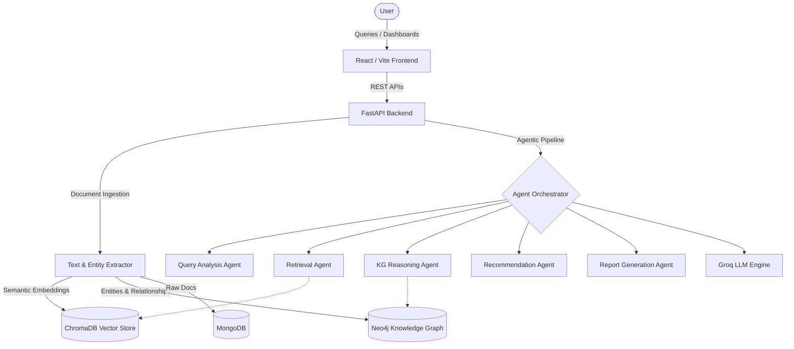

# Building Knowledge Intelligence System

An AI-driven decision support system for building maintenance and structural assessment. This system leverages Knowledge Graphs, Hybrid RAG, and an advanced 5-Agent Pipeline orchestrating Llama 3 models via Groq.

## System Architecture



## Features

*   **Agentic AI Pipeline:** A highly modular 5-agent architecture (LangGraph style) designed specifically for engineering analysis, ensuring each step of reasoning is explainable, documented, and given a confidence score.
*   **Knowledge Graph (Neo4j):** Explores complex dependencies between structural components, maintenance methods, defects, and engineering standards.
*   **Hybrid RAG (ChromaDB + MongoDB):** Combines semantic similarity search over engineering documents with structured metadata queries.
*   **Explainability & Evaluation:** Built-in benchmarking suites, ablation testing capabilities, and live Pipeline Workflow Visualization.
*   **Modern Dashboard:** React + Tailwind application exposing system health, knowledge graph visualizers, document libraries, and the Engineering Assistant chat interface.

## User Interface Highlights

> [!NOTE]
> *(Insert Screenshots here for the Dashboard, Engineering Assistant, Knowledge Graph Explorer, Evaluation Dashboard, Explainability Workflow, and System Monitoring)*

- **Dashboard**: High-level statistics and recent benchmark runs.
- **Engineering Assistant**: Chat interface with structured, collapsible responses (Generated Report, Recommendations, Retrieved Sources, Execution Trace).
- **Knowledge Graph Explorer**: Force-directed graph of building components and defects.
- **Explainability**: Live visual tracking of which agents fired and their reasoning.
- **Evaluation Dashboard**: Historical tracking of LLM accuracy across architectural configurations.
- **Monitoring**: Real-time ping data for MongoDB, Neo4j, Chroma, and the Groq LLM API.

## Installation & Deployment (Docker)

The recommended way to deploy the Building Knowledge Intelligence System is via Docker Compose.

### 1. Prerequisites
- Docker & Docker Compose
- Groq API Key (Free tier works perfectly)

### 2. First-Time Setup
Run the setup script to initialize environment variables and required directories:
```powershell
.\scripts\setup.ps1
```

### 3. Configure API Keys
Edit the generated `.env` file in the project root and add your Groq API Key:
```env
GROQ_API_KEY=your_key_here
```

### 4. Start the Application
Spin up the entire stack using Docker Compose:
```powershell
.\scripts\start-docker.ps1
```

Or manually:
```bash
docker-compose up -d --build
```

### 5. Access
- **Frontend Dashboard:** [http://localhost:5173](http://localhost:5173)
- **Backend API (Swagger):** [http://localhost:8000/docs](http://localhost:8000/docs)
- **Neo4j Browser:** [http://localhost:7474](http://localhost:7474)

## Project Structure
- `backend/` - FastAPI python application (Agents, RAG, Evaluators, API endpoints).
- `frontend/` - React Vite application.
- `scripts/` - Utilities for quick deployment and testing.
- `docker-compose.yml` - Infrastructure definition.

## Documentation
- [API Reference](docs/API_REFERENCE.md)
- [Architecture Details](#system-architecture)
